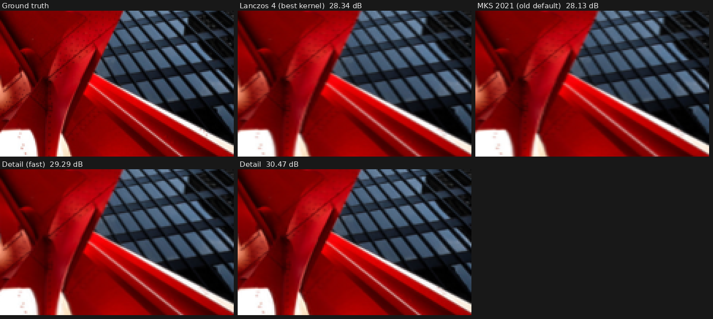
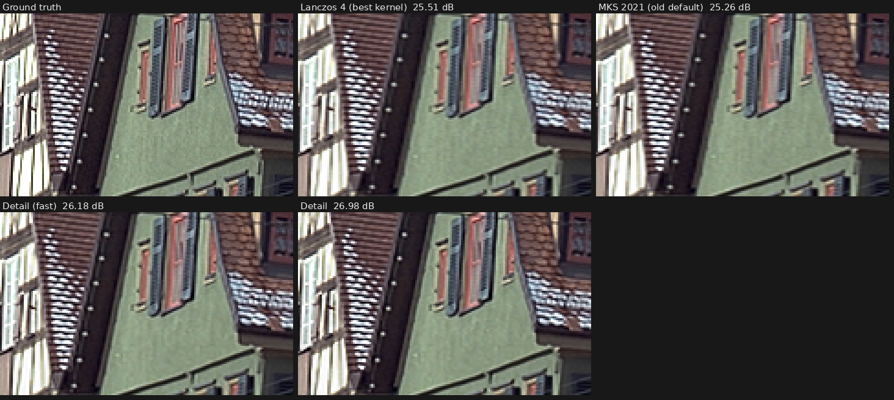

# Desqueeze

A Unity (6.3) desktop app that de-squeezes photos shot through anamorphic lenses: open an image,
inspect it pixel-perfectly, choose the anamorphic factor and how the correction is split between
widening and shortening, apply it, and save as maximum-quality JPEG or PNG. Widening uses a
purpose-built single-axis upscaler that rebuilds detail from the fully sampled axis. Shortening uses a
benchmarked high-quality kernel. A batch mode does the same for every image in a folder, and a
calibration mode finds a lens' exact squeeze factor from a photographed circle and measures its distortion
from lines that should be straight. Lens profiles keep both, so a lens is set up once and applied with one click.

All image processing lives in a plain C# library (`Assets/Desqueeze/Core`, no Unity references),
so it can be tested outside Unity and later given a GPU path behind the same API.

---

## Running it

1. Open this folder in Unity 6.3 (6000.3.11f1).
2. Press **Play** in any scene (the template's `SampleScene` is fine). The app creates itself at
   start-up; nothing needs adding to a scene.
3. To build: **File > Build Profiles**, pick macOS (or Windows/Linux), **Build**.

On first load an editor script sets desktop-friendly player settings (windowed, resizable,
1600 x 1000, keeps running in the background so batches don't pause). Re-apply any time with
**Desqueeze > Apply Recommended Player Settings**.

> The UI is IMGUI (drawn from code), so there are no scene, prefab or UI assets to wire up, and it
> works with the project's "Input System only" setting.

---

## Interactive mode

| Action | How |
|---|---|
| Open | **Open…**, or type/paste a path in the toolbar and press Enter, or Ctrl/Cmd+O |
| Zoom | Mouse wheel (zooms at the cursor), **+ / −**, **Fit**, **1:1**, keys `+` `-` `1` `F` |
| Pan | Drag (left or middle button), arrow keys (Shift = faster) |
| Toggle original / result | **Original / De-squeezed** buttons or Space. Zoom and the relative position are kept, so you compare the same spot |
| Apply | **Apply De-squeeze** (Ctrl/Cmd+Enter) - full resolution, on all cores, cancellable |
| Save | Choose **JPG** or **PNG**, then **Save As…** (Ctrl/Cmd+S). Applies first if the settings changed |
| Calibrate | **Calibrate** (top right): measure a lens' exact factor from a photographed circle (see [Calibration mode](#calibration-mode)) |

**Pixel-perfect viewing.** Magnification is always a whole number (each image pixel becomes an
exact N x N block of screen pixels, point-sampled, at whole-pixel offsets). Zooming out uses exact
1/N reductions: every screen pixel is the linear-light average of an N x N block, computed on
the CPU, never a GPU-filtered approximation. Large images are tiled, so the GPU texture limit doesn't
apply. The status bar shows the pixel under the cursor and its values.

## Batch mode

Pick an input and an output folder. Every `.jpg/.jpeg/.png` is processed with the current settings
and written **in its own format**: JPEG in gives maximum-quality JPEG out, PNG in gives PNG out (16-bit stays
16-bit). Options: include subfolders (mirrors the structure), overwrite existing, file-name suffix.
The originals can never be overwritten: using the input folder as output requires a suffix.
Hidden files and macOS `._` resource forks are ignored.

## Calibration mode

**Calibrate** (top right, next to **Config**) has two tools, chosen with the tabs over the image:
**Squeeze factor** (below) and **Distortion** (see [Distortion correction](#distortion-correction)).
What either measures goes into the current lens profile.

### Squeeze factor

Finds the exact squeeze factor of a lens. A lens marked "1.5x" can be 1.47x or 1.53x, and the
difference shows as subtly oval wheels, faces and lens flares.

1. **Shoot a circle** through the lens: straight on, near the middle of the frame, ideally about half the
   frame height. `Tools/Calibration/calibration-chart.png` is a printable chart (A4, print at 100%). A plate,
   a CD or a round sign works too. `Tools/Calibration/sample-squeezed-1.6x.jpg` is a simulated 1.6x shot of the
   chart for trying the mode without a lens.
2. Open the photo and press **Calibrate** (top right, next to **Config**).
3. **Click inside the squeezed circle.** Dragging still pans, and scrolling zooms. The app finds the circle's
   centre and outline to a fraction of a pixel.
4. The view switches to a **live de-squeezed close-up** of the circle with a **thin red ring**. The ring's
   inside edge sits just outside the radius the circle really has: its size along the axis the lens didn't
   squeeze, scaled by the current split.
5. **Change the factor until the circle exactly fills the ring**, touching its inside all the way round.
   * Use the factor controls in the panel, the **−0.01 / −0.001 / +0.001 / +0.01** buttons over the image, or the
     `[` and `]` keys (Shift for 0.01).
   * The status bar says how far off the circle is ("0.4% too narrow (raise the factor)").
   * **Measured** shows the factor the circle implies, and **Use** sets it.
6. **Done** (or Esc) keeps the factor. To reuse it, add it as a preset in the config file.

The close-up is rendered with the selected kernel, so it updates as you drag. Its geometry is exactly that of
the full de-squeeze.

**How the circle is found.**
1. Rays are cast from the click. Along each one, edges in the linear-light luminance become candidates.
2. RANSAC picks the axis-aligned ellipse most rays agree on: one polarity all round, with the click inside it. For
   a drawn ring outline it takes the outer edge.
3. The edge is re-measured to a fraction of a pixel on 360 rays from that ellipse's centre, and the ellipse is
   refitted geometrically, with outliers trimmed.

The ellipse is kept axis-aligned because the lens squeezes along one image axis. A circle that isn't
facing the camera squarely, or that sits where the lens distorts, fits less well, and the app warns about it.

**Accuracy.** The test set was 320 simulated anamorphic photos:
* objects: a printed dot, a light plate, a clock face with ticks and hands, and a drawn ring outline;
* backgrounds: plain paper, or a busy photograph;
* radii from 35 to 480 px, squeezed by area integration at 1.33-2x;
* half of them with lens blur, sensor noise and JPEG;
* each clicked at a random point inside.

Results for radius 90 px and up:

| Case | Error of the measured factor |
|---|---|
| Solid shapes on plain paper | median 0.005%, worst 0.18% |
| Everything shown without a warning | median 0.005%, 95% within 0.08%, worst 0.42% |

* 0.1% is about 0.0015 at 1.5x, close to one step of the factor's third decimal.
* The simulated chart photo (true 1.6x) measures 1.6004x.
* Every measurement more than 0.5% off came with a warning: a poor fit, only part of the outline found, a very
  small circle, or a thin drawn line.
* The usual failure is a thin line drawn over a busy background, where the finder can lock onto texture inside
  the ring. If that happens, use **Pick another circle**.
* Circles under about 40 px radius, and lines only 2-3 px wide, are measured less precisely; the app says so.
* Finding a circle takes about 0.1-0.3 s.

---

## Lens profiles

A profile holds everything about one lens: its squeeze factor, its distortion, and the calibration lines the
distortion was measured from (so the measurement can be edited later). The **LENS PROFILE** section at the top of
the side panel manages them.

* **The drop-down** chooses a profile from the library, or **No profile**. Choosing one sets the factor and turns
  on its distortion correction. Hovering a profile shows its factor and distortion.
* **While a profile is active, its factor is the factor in the panel.** Changing either changes both, so a
  calibrated factor lands in the profile. The **•** after the name means there are changes that aren't saved.
* **Name** and **Notes** edit the profile. **Save** writes it to the library. **Revert** goes back to the saved
  version, and **Save copy** saves it as a new profile.
* **New** starts an empty profile with the current factor. **Import…** copies a profile file into the library and
  uses it. **Export…** writes the profile anywhere, to share or back up. **Delete** (click twice) removes the file;
  the profile stays loaded, unsaved, so a mistake can be undone with **Save**.
* **Open profile folder** (in the drop-down) shows the library: `Documents/Desqueeze Lens Profiles`, one `.json`
  file per lens. The folder can be changed in the config file.
* Unsaved changes are kept between sessions, so quitting doesn't lose a calibration in progress.
* Batch mode uses the active profile, and its header says which one.

Profiles are plain JSON: the factor, the distortion coefficients (`kx`, `ky`) and the calibration points, in pixels of
the photo as the sensor recorded it. `Tools/LensProfiles` has an example measured from one of the 1.54x sample
photos.

---

## Distortion correction

Lenses bend straight lines: outwards towards the edges (barrel distortion), inwards (pincushion), or both
(moustache). Anamorphic lenses can bend horizontal and vertical lines by different amounts. The app measures this
from a photo and straightens it while de-squeezing.

### Measuring it

1. **Shoot something with straight lines** through the lens: a brick wall, tiles, a building, a printed grid. Fill
   the frame and include the edges and corners, where distortion is strongest. It doesn't need to be square-on,
   because straightness doesn't depend on perspective.
2. Open it and press **Calibrate**, then the **Distortion** tab.
3. **+ Horizontal** (H) or **+ Vertical** (V) starts a line. **Click points along an edge that is straight in
   reality**, from one end to the other. 5-10 points spread along it are plenty. **Enter** (or **Finish line**)
   ends the line.
4. **Add as many lines as you like.** Long lines near the top, bottom, left and right edges measure the most. A
   line needs at least 3 points to count.
5. **Fix points** as needed:
   * Drag a point to move it, or select it and nudge it with the arrow keys (0.25 px, Shift for 2 px).
   * **Delete** removes the selected point. **Shift+Delete** (or **Delete line**) removes its line. Clicking a point
     also continues its line.
   * **Undo** (Ctrl/Cmd+Z) steps back, and **Clear** (click twice) removes every line.
   * Dragging the background pans, as usual.
6. With **Snap** on (the default), each point moves onto the nearest edge to a fraction of a pixel. All of a
   line's points stay on the same side of a mortar joint or frame.

After every change the distortion is fitted again, which takes about 20-50 ms. The overlay shows:
* the points: blue for horizontal lines, orange for vertical ones;
* **green curves** showing where the measured lens puts a straight line through each line's points. When the fit
  is good, the points sit on them;
* **red points**, which are well off their line, probably misplaced.

The status bar shows the straightness error before and after correction, the model the data supports, and advice
when the lines don't reach far enough. **Preview** (P) renders the photo corrected, with straight lines through the
corrected points.

The result goes into the lens profile (an untitled one is created if there was none). **Save** it there.

### Applying it

The **DISTORTION CORRECTION** section of the panel appears when the profile has a measurement:

* **Amount** is 0-150%. At 100% the lines are straight; less keeps some of the lens' character.
* **Auto-crop** gives the largest rectangle, of the photo's shape, that the corrected picture fills completely.
  **Uncropped** keeps every pixel of the photo, and the parts of the frame it no longer reaches are black
  (transparent in PNGs with alpha). Barrel correction leaves those gaps at the middle of each edge.
* The corrected size is shown. The output keeps the de-squeezed resolution at the centre of the frame, where the
  lens is sharpest. A barrel-corrected, auto-cropped image therefore comes out slightly larger than a plain
  de-squeeze (12281 x 5319 instead of 12246 x 5304 for the example profile), and no detail at the centre is
  thrown away.
* **Advanced > Distortion correction order** chooses when the correction happens; see below.

### How it works

**The model.** Coordinates are normalised so that x runs from -1 to 1 across the de-squeezed width, with the same
units vertically:

```
xd = xu (1 + kx1 r² + kx2 r⁴ + kx3 r⁶)
yd = yu (1 + ky1 r² + ky2 r⁴ + ky3 r⁶),     r² = xu² + yu²
```

* Equal x and y coefficients are the classic radial (Brown-Conrady) model. Separate ones describe anamorphic lenses.
* The centre is fixed, so its scale is unchanged.
* The model is mirror-symmetric, so it doesn't matter which way the camera was turned for a portrait shot.
* Points are measured on the photo as shown and stored in the sensor's own orientation, the frame the de-squeeze
  works in.
* Because x is relative to the width, a profile fits any resolution of the same frame.

**The fit** (the plumb-line method):
1. The coefficients are chosen so that, once corrected, each line's points lie on a straight line: Levenberg-
   Marquardt on the perpendicular distances to each line's best total-least-squares line.
2. Huber weighting means one misplaced point barely moves the result. In the tests, a point 25 px off changed the
   correction by under 1 px.
3. The model is picked by the data (Bayesian information criterion), from:
   * radial, 1st order;
   * radial, 2nd order;
   * separate horizontal and vertical, 1st order;
   * separate horizontal and vertical, 2nd order.
4. A direction only gets its own coefficient when its lines are long and reach towards the edges. Otherwise short
   lines would extrapolate wildly into the corners, which the first real test did until this check was added.

On synthetic lines with 0.25 px of noise, the fit recovers barrel, pincushion and anamorphic lenses to within
0.1-0.7 px everywhere in a 9000-px-wide frame.

**The warp** follows the structure of Fisheye Friend's CPU renderer:
* Each output pixel is mapped back through the lens to the photo, and nearby source pixels are combined with
  normalised Lanczos-3 weights.
* Colour is premultiplied by alpha and edges are clamped.

It differs in three ways:
* **Its half-pixel offset is fixed.** Fisheye Friend measures source distances from `x + 0.5`, which shifts the image
  by half a pixel.
* **The Lanczos kernel is separable** (x and y) instead of radial. A radial sinc doesn't vanish at the diagonal
  neighbours, so it blurs even where nothing moves. It scored 1.6-3.9 dB lower (below). The separable kernel
  reproduces the image exactly where the correction is zero.
* **The footprint widens where the correction shrinks the image**, following the local Jacobian, so pincushion
  corrections don't alias. The boundary of the photo is anti-aliased against the background.

The warp runs in sigmoidal light (gamma for images with alpha), reads the de-squeezed image at 16 bits, and is
multi-threaded. It adds about 17 s to a 65 MP de-squeeze on a 2-core machine, and a few seconds on a modern Mac.

### Before or after the de-squeeze? What was measured

The 4 sample photos (1.54x) were the scenes. Each was shot through a simulated lens with 1.54x squeeze, by area
integration at 4x4 samples per sensor pixel in linear light, then stored as an 8-bit capture. This was done:
* with mild distortion (radial k1 = -0.015, about the lens in the samples);
* with strong anamorphic distortion (-0.08 / -0.04 with second-order terms);
* clean, or softened like a real lens (0.4 px blur).

Each pipeline then corrected and de-squeezed back to the frame. PSNR was measured against the scene integrated
over the output pixels (dB, mean of 4 scenes):

| Pipeline | Mild, clean | Mild, soft | Strong, clean | Strong, soft |
|---|---|---|---|---|
| **De-squeeze (Detail), then correct** (default) | 34.27 | **34.58** | 33.92 | **34.19** |
| Correct, then de-squeeze (Detail) | 33.83 | 34.07 | 33.55 | 33.67 |
| One pass, capture to output (warp kernel only) | **34.50** | 33.59 | **34.04** | 33.16 |
| De-squeeze (Kernel), then correct | 34.56 | 33.59 | 34.10 | 33.16 |
| Correct, then de-squeeze (Kernel) | 34.07 | 33.22 | 33.63 | 32.80 |
| De-squeeze (Detail), then correct with Fisheye Friend's radial Lanczos | 31.05 | 32.80 | 30.87 | 32.57 |

* **De-squeezing first wins** by 0.4-0.5 dB, whether the Detail widener or the kernel does the de-squeeze. Correcting first resamples the photo before the widener sees it, so the widener no longer works from
  the lens' own pixel grid. The squeezed axis is also interpolated twice.
* **One pass** is a single resampling, but it can't use the Detail widener. It is slightly ahead on perfectly crisp
  captures, where the kernel also beats Detail without any distortion (35.18 vs 34.73 dB). On soft captures, which
  is what real lenses give, it is 1 dB behind. So de-squeezing first is the default, and the others are under
  **Advanced**.
* **The warp kernel matters most.** The radial Lanczos lost 1.6-3.2 dB here, and 2.4-3.9 dB with no distortion at
  all, which is pure blur.
* The other warp settings made little difference:
  * Light space: sigmoidal +0.01-0.03 dB over gamma, linear -0.2 to -0.6 dB.
  * Radius: 2 lobes -0.2 to +0.1 dB, 4 lobes ±0.02 dB.
  * Catmull-Rom bicubic: -0.2 to +0.1 dB.

  The defaults are separable Lanczos 3 in sigmoidal light.

### The lens in the sample photos

The distortion was measured on `street_nov11-185.jpg` from 15 straight edges: doors, window frames and signs,
190 points. Curbs, steps and other edges that aren't really straight were left out.

* **Barrel distortion**, radial k1 = -0.0153: about 1.0% of the width at the edges, roughly 128 px across the
  12,246-px de-squeezed image.
* Straightness went from 1.02 to 0.95 px RMS. The edges in the photo are only straight to about a pixel, so that
  is the floor.
* The edges were near the middle of the frame, so horizontal and vertical bending couldn't be told apart, and the
  app says so. A brick wall filling the frame would measure the corners better and show whether this lens bends
  the two directions differently.

`Tools/LensProfiles/Example 1.54x (street_nov11-185).json` is that measurement; **Import…** it to try it.

---

## The controls

**Anamorphic factor.** Preset buttons come from the config file (1.33x, 1.5x, 1.6x; default
1.5x), plus **Custom** for any value in the configured range.

**Squeeze direction.** **Auto** (default), **Horizontal** or **Vertical**. Auto follows the camera:
a shot taken with the camera turned 90° is de-squeezed vertically, everything else horizontally (see
[Camera orientation](#camera-orientation-portrait-shots)). The line under the buttons says what Auto
decided for the open image and why. Horizontal and Vertical override it for every image.

**Height / width split (one slider).** Any output whose aspect is *factor x source aspect* is a
correct de-squeeze. The slider chooses how much comes from widening versus shortening, and is locked so
`widthScale / heightScale = factor` always holds:

```
widthScale  = factor ^ t
heightScale = factor ^ (t - 1)          t = slider position, 0..1

t = 0    Height only   width x1,           height x1/factor   (e.g. 1.33x -> height x0.752)
t = 0.5  Balanced      width x sqrt(f),    height x1/sqrt(f)  (same total pixel count)
t = 1    Width only    width x factor,     height x1          (keeps every captured row)
```

The panel shows both scale factors and, with an image open, the exact output size, aspect and
megapixels. Rounding to whole pixels changes the aspect by less than 0.05%.

For a vertical squeeze the roles swap: the slider runs from **Width only** (narrow the width) to
**Height only** (stretch the height, keeping every captured column). The right end adds resolution in
both directions, and one slider position serves both.

**Widening.** How the stretched axis is enlarged:

* **Detail** (default): cross-axis detail reconstruction (described below). It rebuilds horizontal
  detail from the fully sampled vertical axis, so it is sharper than any interpolation kernel. It is also slower.
* **Detail (fast)**: the learned filters only, without the detail network. You get about half the gain in under half the time.
* **Kernel**: classic interpolation with the selected kernel (the only option before).

Widening only adds resolution when the slider is toward **Width only**. At *Width only*, every captured
row is kept and all of the correction is widening. With a split, the image is widened by `factor ^ t` and
the other axis is then shortened with the selected kernel.

**Resampling.** Algorithm list, plus **Advanced**: the light space used for the shrinking axis and
for the enlarging axis, and optional anti-ringing for the enlarged axis. With **Detail**, the kernel
is only used for shortening.

---

## Camera orientation (portrait shots)

An anamorphic lens squeezes along the sensor's long side. Turn the camera 90° for a portrait shot and
the lens turns with it, so in the upright picture the squeeze runs **vertically**.

**What the camera records.** Cameras (and phones) store the sensor's pixels as read out, still sideways,
and write how the camera was held into the EXIF orientation tag: 6 or 8 for a quarter turn. Viewers
read the tag and show the picture upright. Unity's JPEG decoder ignores the tag.

**What the app does.**

1. **On load**, the image is turned upright from its tag (JPEG APP1 or PNG eXIf, all eight EXIF
   orientations), and the tag is reset to 1 so the metadata matches the pixels. The viewer shows the
   picture the way the camera meant it.
2. **Auto** picks the axis:
   * tag 5-8 (camera turned 90°): vertical;
   * no tag, or a "level" tag, but the image is taller than wide: vertical. Software that rotates the
     pixels itself usually resets the tag, and a sensor is never taller than wide;
   * anything else: horizontal.
3. **De-squeezing vertically** turns the image a quarter turn, runs exactly the horizontal pipeline
   (Detail, Detail fast or Kernel, the slider, the light spaces), and turns the result back. When the
   tag says how the camera was turned, the internal turn undoes exactly that turn, so the resampler
   works on the sensor's own pixels. The result is bit-identical to de-squeezing the sideways file and
   rotating it afterwards.
4. **On save**, the output is written upright with orientation 1. The EXIF thumbnail link is removed:
   the embedded thumbnail is a small copy of the squeezed capture, which would show the wrong shape.

**Turning by rotation vs. by transposing.** A quarter turn can be a true 90° rotation, or a transpose
(rows become columns, which is a rotation plus a mirror). On 198 held-out cases (22 photos x 1.33/1.5/1.6x x
three camera conditions, squeezed vertically), Detail scored the same either way. Clockwise rotation was
+0.01 dB, counter-clockwise −0.00 dB, against transposing. The model was trained on mirrored images,
so the mirror makes no difference. The app rotates.

**Checked against real files.**
* The 18 test JPEGs of [exif-orientation-examples](https://github.com/recurser/exif-orientation-examples)
  (every orientation, landscape and portrait) come out pixel-identical to Pillow's `exif_transpose`.
* EXIF blocks from 53 real camera and phone files in [exif-samples](https://github.com/ianare/exif-samples):
  * 52 read the same orientation as Pillow. The 53rd has no orientation tag in its main EXIF directory, and
    the app treats it as untagged.
  * After the orientation reset and thumbnail removal, every other tag is unchanged in all 53.

---

## Choosing "the best" kernel - what was measured

The kernels are used for shortening, and also for widening when **Widening** is set to **Kernel**.
Detail widening is covered in the next section.

Rather than assume, I benchmarked the candidates: windowed-sinc (Lanczos 3/4), Panorama Tools
splines (36/64), Magic Kernel Sharp 2021 (Costella, used by Facebook/Instagram and libvips),
EWA Lanczos Sharp (the radial Jinc filter mpv and ImageMagick use for their best upscaling), cubics,
bilinear and box. Each was also tested in linear, gamma and sigmoidal light.

Method (`Tools/QualityBenchmark/benchmark.py`): 16 ground-truth photos and textures, including
full-resolution Kodak PhotoCD scans. Each was squeezed horizontally by 1.33x, 1.5x and 2x to
simulate a capture (two sensor models: an ideal area-integrating sensor, and a sharp no-AA-filter
one), then de-squeezed. **Width-only results are scored against the exact original** (no reference
filter bias). Balanced and height-only results are scored against the original area-reduced in linear
light. Metrics: PSNR, SSIM, GMSD.

Mean PSNR (dB) with the chosen light spaces (shrink in gamma, enlarge in sigmoidal):

| Kernel | Width only (area / sharp) | Balanced (area / sharp) | Height only (area / sharp) | Average |
|---|---|---|---|---|
| **Magic Kernel Sharp 2021** | **37.10** / 38.75 | **35.57** / **36.25** | **43.37** / 38.55 | **38.26** |
| Spline 64 | 37.05 / 38.86 | 35.42 / 36.10 | 42.68 / 38.29 | 38.07 |
| Lanczos 3 | 37.08 / 38.83 | 35.39 / 36.02 | 42.61 / 38.22 | 38.02 |
| Lanczos 4 | 37.04 / **38.94** | 35.35 / 36.02 | 42.36 / 38.11 | 37.97 |
| Catmull-Rom | 36.37 / 37.63 | 35.46 / 36.14 | 43.21 / **38.59** | 37.90 |

Findings:

* **Light space matters more than the kernel.** Enlarging in *sigmoidal* light beat linear light by
  0.6-0.9 dB for every kernel (sharp filters' overshoot is compressed instead of becoming halos).
  Shrinking in *gamma* light beat linear light by 0.25-1.0 dB: linear-light reduction with a sharp
  kernel crushes the dark side of high-contrast edges to black (about 39 sRGB levels of halo). This
  held even though the reference itself was made in linear light.
* **Magic Kernel Sharp 2021** has the best average and is first or near-first in every scenario,
  so it is the default. Lanczos 4 is marginally sharper (+0.19 dB) for pure widening of very crisp
  (no AA filter) captures and is one click away.
* **EWA Lanczos Sharp scored 0.3-0.5 dB lower** for de-squeezing. It is a 2-D filter, so it also softens
  the axis that isn't being resized. It's included for comparison.
* An axis that isn't resized (e.g. height at "Width only") passes through bit-exact.

Re-run the benchmark on your own images:
`python3 Tools/QualityBenchmark/benchmark.py --images ~/some/photos --work /tmp/desq-bench`
(needs the .NET 8 SDK for `Tools/Bench`, plus numpy, pillow, scipy, scikit-image).

---

## Widening that adds detail: cross-axis reconstruction

Shortening throws captured rows away. Widening keeps them all, but a kernel can only interpolate
between the samples of each row, so the widened image is soft. **Detail** widening is a single-axis
upscaler built for anamorphic captures. It works up to about 2x and does best at 1.6x and below. It rebuilds
horizontal detail mainly from the information in the axis that wasn't squeezed.

### Why the other axis helps

A horizontally squeezed capture is sampled at full density vertically and at 1/factor density
horizontally. Lanczos and Magic Kernel treat each row as an independent 1-D signal, so detail beyond
one row's sampling limit is gone. But any edge that isn't exactly vertical crosses consecutive rows at
different horizontal sub-pixel offsets. Together, the rows above and below sample that edge more finely
than any single row does. This is the same principle as a slanted-edge MTF measurement. The local edge
angle, which the fully sampled vertical axis measures well, says how to combine them.

### The algorithm

For every output pixel, at input position *u*: column *j0* = floor(*u*), phase = *u* − *j0*.

1. **Local geometry.** The 2-D structure tensor of the input (gradients smoothed with a Gaussian, σ = 1 px) is
   interpolated at *u*. It gives the edge angle (16 bins), strength (3) and coherence (3).
2. **Cross-axis learned filter.** A **7-row × 6-column** filter is looked up by angle, strength and
   coherence. It takes taps from the 3 rows above and below, not just the pixel's own row, and is
   blended between the two nearest of 16 sub-pixel phases. The 2,304 filters are solved by
   constrained least squares on simulated anamorphic captures: sensor area integration, lens blur,
   in-camera sharpening, noise and JPEG, at factors 1.15-2.0. The idea comes from RAISR [1], reworked for one
   axis. RAISR does integer 2-D upscales with square patches. Here the sub-pixel phase is a bucket
   dimension, because a non-integer one-axis scale has a continuum of phases, and the window is tall
   so it reaches across rows.
3. **Detail network.** A small network (45 → 32 → 24 → 1, leaky ReLU) predicts the filter's remaining
   error, the predictor idea of NNEDI3 [2]. Its inputs are the same window (contrast-normalised), the phase, the scale and the
   filter's result. It runs once, on luma. Each colour channel gets the correction scaled by its
   local regression slope against luma, as a guided filter [3] does, so colour edges stay aligned at a
   third of the cost. Flat areas (window standard deviation < 0.02) skip the network.
4. **Shortening, if any.** When the slider also shortens the other axis, the widened image is kept at 16 bits and
   then shortened with the selected kernel. A vertical squeeze is turned a quarter turn, de-squeezed
   horizontally, and turned back (see [Camera orientation](#camera-orientation-portrait-shots)).

### Results

The held-out test set has 77 images: Kodak (24), Urban100 51-100, and 3 Kodak high-resolution scans.
None of them was used for training. Each was squeezed at 4 factors under 4 capture conditions, which
gives 1,232 cases. The slider was at *Width only*, and results are scored against the ground truth. Higher PSNR and
SSIM are better. Lower GMSD is better.

| Capture simulation | Lanczos 4 | MKS 2021 | Detail (fast) | **Detail** | Detail vs Lanczos 4 |
|---|---|---|---|---|---|
| Sensor area integration | 32.41 | 32.17 | 33.31 | **34.17** | +1.76 dB |
| + soft lens / OLPF (0.4 px) | 33.57 | 33.30 | 34.67 | **35.61** | +2.04 dB |
| + soft lens + in-camera sharpening | 29.86 | 29.64 | 30.72 | **31.41** | +1.55 dB |
| + soft lens + JPEG quality 90 | 31.06 | 30.94 | 31.61 | **32.14** | +1.08 dB |
| All cases, PSNR | 31.72 | 31.51 | 32.58 | **33.33** | +1.61 dB |
| All cases, PSNR on edge pixels | 26.31 | 26.00 | 27.25 | **28.47** | +2.16 dB |
| All cases, SSIM | 0.9472 | 0.9463 | 0.9541 | **0.9570** | |
| All cases, GMSD | 0.0632 | 0.0652 | 0.0557 | **0.0507** | −20% |

| Factor | Lanczos 4 | Detail (fast) | **Detail** | Gain |
|---|---|---|---|---|
| 1.33x | 33.49 | 34.46 | **35.53** | +2.04 dB |
| 1.5x | 32.21 | 33.17 | **33.98** | +1.77 dB |
| 1.6x | 31.51 | 32.42 | **33.17** | +1.66 dB |
| 2x | 29.68 | 30.25 | **30.65** | +0.97 dB |

* **+1.6 dB means about 31% less squared error.** The gain is concentrated on edges and fine texture,
  which is where widening looks soft.
* **Detail beat Lanczos 4 in 98.5% of the cases.** The exceptions were the three smooth high-resolution
  scans. Their average gain shrinks to +0.2 dB, and one of them was up to 1 dB worse when in-camera
  sharpening was simulated. That was above 41 dB, where differences are very hard to see.
* **The gain shrinks above 1.6x.** At 2x there is more missing detail than the neighbouring rows can supply.
* **No sign that design choices overfit.** 320 of the cases use images from the 20-image development
  set that guided those choices. The other 912 cases were never looked at, and gained +1.58 dB, against
  +1.69 dB on the development images.
* **Other conditions** (development set, all factors):
  * Sensor noise: Lanczos 4 33.56, Detail 35.26 (+1.70 dB).
  * Stress test, a capture made with an ideal sinc (Lanczos) filter: Lanczos 4 35.20, Detail 34.37 (−0.83 dB).
    Real sensors integrate over the pixel area, so this only happens when the source has already
    been sinc-resampled. In that case, use **Kernel**.

Two held-out examples (1.5x, 3x nearest-neighbour zoom), in `Tools/AxisSR/examples`:




### What was tried, and what didn't work

The table uses the development set (20 images), 1.5x, mean of the plain-sensor and soft-lens captures.

| Approach | PSNR (dB) | vs Lanczos 4 |
|---|---|---|
| Lanczos 4, sigmoidal (best kernel) | 35.60 | — |
| Magic Kernel Sharp 2021 | 35.26 | −0.34 |
| Classic edge-directed: average along the detected edge across rows (ELA/NEDI-style), best of 3 tunings | 35.20 | −0.40 |
| Learned filters, own row only (1 × 6), chosen by 2-D edge angle | 36.72 | +1.12 |
| Learned filters, 7 rows × 6 (cross-axis) | 36.95 | +1.35 |
| Same, plus 16 blended phases | 37.00 | +1.40 |
| Finer angle bins (32, 48), other tensor scales, 9-row window | ≤ 37.00 | no gain |
| New: fit a sub-pixel step edge across the rows, then transfer its vertical edge profile to the horizontal axis | 37.15 | +1.55 (+0.07 over the filters it refined) |
| New: sub-pixel edge position as an extra bucket dimension | 37.11 | +1.51 (+0.03) |
| Flip test-time augmentation (4 passes) | 37.09 | +1.49 (+0.09, at 4x the cost) |
| **Learned filters + detail network** | **38.21** | **+2.61** |

What the table shows:

* Classic edge-directed interpolation, which averages along the edge across rows, is worse than Lanczos 4.
  Hand-made rules can't weigh noise, blur and aliasing correctly. Learned weights can.
* A learned filter confined to the pixel's own row already gains 1.1 dB. It knows the capture blur and
  uses the 2-D edge angle. Reaching across rows adds about 0.25 dB on average, and 0.4-0.55 dB on edges
  10-50° from vertical, where rows add phase diversity. Near-vertical edges remain the hardest: they
  account for about 40% of the remaining error, and the rows can't help there.
* The step-edge transfer model was spectacular on synthetic edges but added only 0.07 dB on photos,
  for a lot of code. It was dropped. So were the edge-position feature and test-time augmentation.
* The detail network is the largest single gain, but it learns the capture it was trained on. The
  38.21 network was trained on clean captures only, and it fell 1.6 dB *below* Lanczos on a
  sinc-filtered source. The shipped model is trained across random camera processing: blur,
  sharpening, noise and JPEG. That costs about 0.9 dB on these two clean conditions (37.29), but it
  stays ahead of Lanczos on every realistic condition in the results above. The shipped 32-24 luma network with flat
  skip costs another 0.2 dB, and does about 8x less network arithmetic than a 64-48 network per channel.

### Speed

CPU, C# (`AxisSR.cs`), 3000 × 2000 → 4500 × 2000, measured on 2 cores (.NET 8):

| Widening | Time |
|---|---|
| Kernel (Lanczos 4 or MKS 2021) | 0.27 s |
| Detail (fast) | 1.9 s |
| Detail | 5.0 s |

Time grows with the output pixel count and divides across cores. For a 24 MP photo on an 8-core Mac,
expect very roughly 10 s with **Detail**. That is an estimate, not a measurement: Unity's Mono runtime
in the editor is slower than .NET 8, and an IL2CPP build is faster.

[1] Romano, Isidoro, Milanfar, *RAISR: Rapid and Accurate Image Super Resolution*, IEEE TCI 2017.
[2] tritical, *NNEDI3* (neural-network edge-directed interpolation), VapourSynth/AviSynth filter.
[3] He, Sun, Tang, *Guided Image Filtering*, ECCV 2010 / TPAMI 2013.

## Output quality

* **JPEG** is always written at the maximum: quality 100 (every quantisation step = 1), 4:4:4 (no chroma
  subsampling), floating-point colour conversion and DCT straight from the source samples (16-bit
  sources aren't rounded to 8-bit first), and Huffman tables optimised per image. On test images it
  measured about 0.3 dB higher PSNR than libjpeg-turbo at quality 100 / 4:4:4, usually in a smaller file.
* **PNG**: lossless, adaptive row filters, parallel DEFLATE. Bit depth, gray/RGB and alpha are preserved.
* **Metadata**: EXIF (camera, lens, exposure, GPS) and ICC profiles are carried into the output (also
  across formats). The EXIF pixel-dimension tags are updated to the new size. The pixels are saved upright,
  so the orientation tag is 1, and the stale EXIF thumbnail is unlinked.
* Resampling is done in float on all cores. Colour is premultiplied by alpha, so transparent pixels don't bleed.

---

## Configuration

`Assets/StreamingAssets/desqueeze-config.json` (in a build: next to the app's data, or use the
**Config** button). Restart the app after editing. Fields you leave out keep their defaults.

```json
{
    "presets": [
        { "name": "1.33x", "factor": 1.33 },
        { "name": "1.5x",  "factor": 1.5 },
        { "name": "1.6x",  "factor": 1.6 },
        { "name": "1.8x",  "factor": 1.8 },          <- add more like this
        { "name": "2x",    "factor": 2.0 }
    ],
    "defaultFactor": 1.5,
    "customFactorMin": 1.0, "customFactorMax": 3.0,
    "defaultWidthShare": 0.5,                         // 1 = width only (keeps every captured row)
    "widenMethod": "Detail",                          // Detail | DetailFast | Kernel
    "squeezeAxis": "Auto",                            // Auto | Horizontal | Vertical (the default direction)
    "defaultAlgorithm": "MagicKernelSharp2021",      // or Lanczos3, Lanczos4, Spline64, EwaLanczosSharp, ...
    "reduceLight": "Gamma",                           // Gamma | Linear | Sigmoidal
    "enlargeLight": "Sigmoidal",
    "antiRinging": 0.0,
    "defaultSaveFormat": "jpg",
    "batchFileSuffix": "_desqueezed",
    "uiScale": 0,                                     // 0 = automatic (2 on Retina)
    "maxZoom": 64,
    "lensProfileFolder": "",                          // "" = Documents/Desqueeze Lens Profiles; ~/ works
    "distortionEdges": "AutoCrop"                     // AutoCrop | Uncropped (the default after correction)
}
```

(The real file can't contain the `//` and `<-` notes shown above.)

The detail model is `Assets/StreamingAssets/desqueeze-axissr.bin`. If it is missing, the app says so
and widening falls back to the kernel. `Tools/AxisSR` retrains it.

The app also remembers your last settings and folders. **Advanced > Reset to defaults** returns to
the config values, and **Desqueeze > Forget Remembered Settings** in the editor clears them.

---

## Project layout

```
Assets/Desqueeze/
  Core/                 Desqueeze.Core  - pure C# (.NET Standard 2.1), no Unity references
    Geometry/           DesqueezeGeometry (the split maths), DesqueezeSettings, AxisChooser (Auto direction)
    Resampling/         kernels, axis weights, separable + EWA resamplers, light-space conversion,
                        AxisSR (the cross-axis detail widener and its model loader)
    Color/              sRGB tables, sigmoidal curve
    Codecs/             PNG reader/writer, max-quality JPEG encoder, JPEG marker reader, EXIF reader/patcher
    Imaging/            PixelImage (8/16-bit, 1-4 channels), display reductions, EXIF orientations, transpose
    Batch/              folder scanning and output naming
    Calibration/        CircleFinder (finds a squeezed circle), CalibrationPreview (close-up + ring geometry)
    Lens/               DistortionModel, DistortionFit (plumb-line fit), LensCorrection (canvas, crop, warp map),
                        EdgeSnap, LensProfile + LensProfileJson, DistortionSummary
    Resampling/WarpResampler.cs   the general warp (separable or radial Lanczos, EWA footprint, AA boundary)
    Desqueezer.cs       entry point: Desqueezer.Process(image, settings, progress, cancel)
  App/                  Desqueeze.App   - Unity layer: IMGUI UI, viewer, dialogs, modes
  Editor/               player-settings helper and Desqueeze menu
  Tests/                EditMode tests (Window > General > Test Runner)
Assets/StreamingAssets/desqueeze-config.json
Assets/StreamingAssets/desqueeze-axissr.bin   the trained detail model (387 KB)
Tools/Bench/            command-line harness for the core (dotnet run -- selftest | axissr ...)
Tools/QualityBenchmark/ the kernel benchmark above
Tools/AxisSR/           training pipeline for the detail model (see its README)
Tools/Calibration/      printable calibration chart, a simulated 1.6x photo of it, and the script that makes both
Tools/LensProfiles/     an example lens profile measured from one of the 1.54x sample photos
```

JPEG pixels are decoded by Unity's `ImageConversion` on the main thread. Everything else
(PNG decode, resampling, encoding, file IO) runs on worker threads. Native file dialogs are used
in the Editor, on macOS (AppleScript), on Windows (PowerShell/WinForms) and on Linux (zenity), and
the toolbar path fields work as a fallback anywhere.

### Adding the GPU path later

`Desqueezer.Resize` is the single dispatch point. A GPU implementation can reuse `AxisWeights`
(start index, tap count and normalised weights per output pixel) as the weight buffers for two
compute passes, and apply the same per-pass light spaces (decode, then sigmoidal or gamma, then the
pass, then encode). Keep the CPU path as the reference: run it through `Tools/Bench` and the
benchmark to check the GPU output matches.

The detail widener is a good fit for a compute shader. Every output pixel is independent: a structure
tensor lookup, a 42-tap filter fetched from a table, and a 45-32-24-1 network. The CPU version
(`AxisSR.cs`) processes bands of 16 rows, and its per-pixel code ports almost line for line.

## Limitations

* The detail model was trained on simulated captures: an area sensor, optical blur, sharpening, noise
  and JPEG. On sources that already have hard ringing, such as images that were sinc-resampled, it can lose to
  Lanczos (see the stress test above). If an image looks wrong, choose **Kernel**.

* CMYK and arithmetic-coded JPEGs aren't supported (Unity's decoder). JPEG input is 8-bit, and its
  size is limited by the GPU's maximum texture size (16384 on most Macs). PNG has no such limits.
* Colour is assumed to use the sRGB transfer curve for linear and sigmoidal processing. ICC profiles
  are preserved but not converted.
* The distortion model is radial, with separate horizontal and vertical terms. It has no decentring (tangential)
  terms, which a tilted or badly assembled lens would need, and assumes the distortion is centred in the frame.
  Profiles apply to photos of the full frame; a photo cropped before de-squeezing has a different centre.
* The distortion can only be measured from lines the user places. Automatic line or grid detection isn't there yet.
* **Auto** falls back to the image's shape when a file has no orientation tag. A landscape shot cropped
  to a portrait shape before de-squeezing would be taken as vertical; choose **Horizontal** for those.
  Orientation stored only in XMP (not EXIF) is not read.
